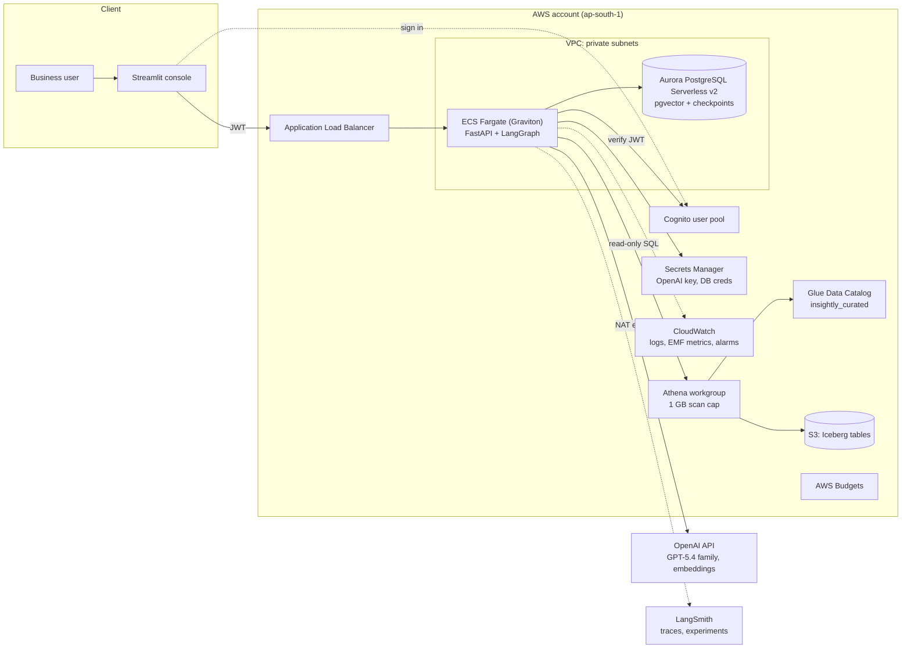
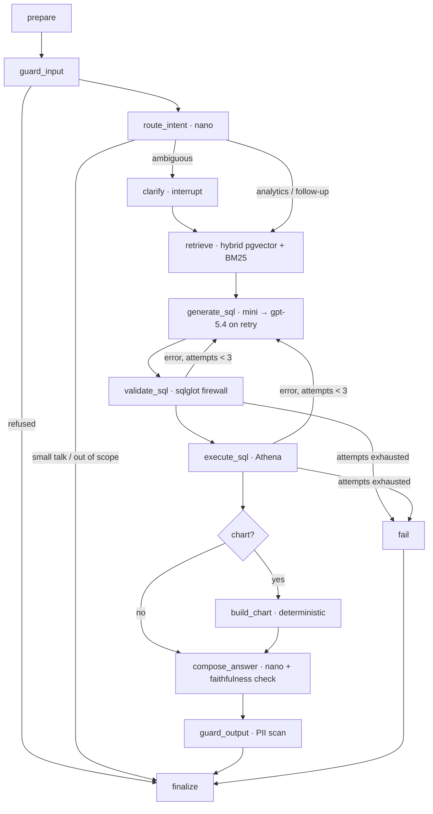

# Insightly

**Governed natural-language analytics for retail.** Business users ask a question in plain
English. Insightly answers with a number, a chart, the SQL it ran and the certified metric
definition it used. Access rules, cost limits and quality gates are enforced on every request.

```
"Return rate by distribution center in 2023, as a chart"
  → guard → route → retrieve certified metric "return_rate" → write Trino SQL → SQL firewall
  → Athena (read-only, 1 GB scan cap) → Plotly spec → grounded answer + SQL + cost in USD
```

| | |
|---|---|
| **Agent** | LangGraph 1.2 state machine with a bounded self-repair loop, human-in-the-loop clarification, per-user memory |
| **Models** | OpenAI (paid): `gpt-5.4-nano` router, `gpt-5.4-mini` SQL, `gpt-5.4` escalation, `text-embedding-3-small` |
| **Data** | S3 + Glue Data Catalog + Athena (Iceberg tables), PII split into a table the service cannot read |
| **Service** | FastAPI with SSE streaming on ECS Fargate (Graviton) behind an ALB, Cognito auth, MCP server |
| **State** | Aurora PostgreSQL Serverless v2: pgvector (semantic layer) + LangGraph checkpoints |
| **Quality** | 35 golden + 10 red-team cases, 30+ metrics, CI release gate, LangSmith experiments |
| **Cost** | Per-request ledger and budget, model cascade, prompt + answer + embedding caches, AWS Budgets |
| **Improve** | Feedback → dataset builder (leak-checked) → OpenAI SFT / RFT → eval gate → canary |
| **IaC** | AWS CDK v2 (Python), 5 stacks, GitHub Actions with OIDC |

---

## Contents

1. [The problem](#1-the-problem)
2. [Architecture](#2-architecture)
3. [Repository layout](#3-repository-layout)
4. [Local setup in VS Code (step by step)](#4-local-setup-in-vs-code-step-by-step)
5. [Run the pipeline locally](#5-run-the-pipeline-locally)
6. [Evaluation](#6-evaluation)
7. [Cost management](#7-cost-management)
8. [Fine-tuning](#8-fine-tuning)
9. [Deploy to AWS (service by service)](#9-deploy-to-aws-service-by-service)
10. [Operations](#10-operations)
11. [Design documents](#11-design-documents)
12. [Troubleshooting](#12-troubleshooting)

---

## 1. The problem

Merchandising, marketing and operations teams in an online fashion retailer ask the data team
the same kinds of questions every day ("return rate for Jeans last quarter by warehouse?").
Each one waits in an analyst queue, and two analysts often compute "revenue" two different
ways. Insightly is **trusted self-serve analytics**:

* **Correct:** answers use certified metric definitions owned by the data team (`semantic_layer/`).
* **Explainable:** every answer shows the SQL, the metric definition and the row count.
* **Safe:** read-only SQL firewall, PII never reachable, prompt-injection and moderation checks.
* **Affordable:** a hard budget per question and per user per day; median cost is fractions of a cent.
* **Measured:** nothing ships unless the evaluation gate passes.

Service level objectives (launch targets, measured by `insightly eval run` and CloudWatch):

| SLO | Target |
|---|---|
| Execution accuracy on the golden set | ≥ 85% (release), ≥ 90% (goal) |
| p95 end-to-end latency | ≤ 12 s |
| PII leaked to unauthorised roles | 0 |
| Cost per question (LLM + Athena) | ≤ $0.03 |

## 2. Architecture



The agent is an explicit LangGraph graph, not a free-roaming agent:



Full design: [docs/architecture.md](docs/architecture.md). Decisions: [docs/adr/](docs/adr/).

## 3. Repository layout

```
Insightly/
├── src/insightly/
│   ├── agent/            graph.py (LangGraph), nodes.py, prompts.py, sql_guard.py, guards.py,
│   │                     chart.py, faithfulness.py, service.py (ask entry point)
│   ├── api/              FastAPI app, Cognito JWT auth, request/response schemas
│   ├── llm/              gateway.py (OpenAI tiers, structured output, cost capture), offline.py
│   ├── semantic/         semantic layer loader, embeddings (+cache), hybrid retriever
│   ├── data/             synthetic generator, curation rules, DuckDB/Athena engines, S3/Glue publisher
│   ├── eval/             metrics, runner, report + gate, LangSmith experiments
│   ├── cost/             price book, per-request ledger, budgets, caches, projection
│   ├── finetune/         dataset builder (leak checks), OpenAI SFT/RFT jobs
│   ├── observability/    structured logs + CloudWatch EMF metrics
│   ├── mcp_server.py     MCP tools for other agents/IDEs
│   └── cli.py            `insightly ...` commands
├── semantic_layer/       tables.yaml, metrics.yaml (certified), examples.yaml (verified SQL)
├── evals/                golden/, redteam/, thresholds.yaml
├── config/pricing.yaml   model prices used by the cost ledger
├── infra/                AWS CDK app (5 stacks)
├── ui/streamlit_app.py   web console
├── tests/                43 tests, no network needed
├── docs/                 architecture, AWS guide, evaluation, cost, security, ADRs, runbook
└── .github/workflows/    ci, eval-openai (nightly), deploy (OIDC)
```

## 4. Local setup in VS Code (step by step)

**Python version: 3.12.** Every dependency publishes 3.12 wheels (including `duckdb`,
`psycopg[binary]`, `pyarrow`, `aws-cdk-lib`), it is the Python used by the Docker image and
by AWS Lambda/ECS base images, and it avoids the build-from-source issues that still occur
with some packages on 3.13/3.14. `pyproject.toml` pins `>=3.12,<3.13` so nobody drifts.

### Step 1. Install the tools (once per laptop)

| Tool | Why | Install |
|---|---|---|
| VS Code | editor | https://code.visualstudio.com |
| Git | version control | https://git-scm.com |
| uv 0.11+ | Python + venv + lockfile manager | `curl -LsSf https://astral.sh/uv/install.sh \| sh` (macOS/Linux) or `powershell -c "irm https://astral.sh/uv/install.ps1 \| iex"` (Windows) |
| Node.js 22 LTS | AWS CDK CLI | https://nodejs.org |
| AWS CLI v2 | AWS login and secrets | https://docs.aws.amazon.com/cli/latest/userguide/getting-started-install.html |
| Docker Desktop | optional local stack, required for `cdk deploy` (builds the image) | https://www.docker.com/products/docker-desktop |

Check:

```bash
uv --version        # uv 0.11.x
node --version      # v22.x
aws --version       # aws-cli/2.x
docker --version    # optional for local, required for deploy
```

### Step 2. Clone and open in VS Code

```bash
git clone https://github.com/Pradipwasre/Insightly.git
cd Insightly
code .
```

VS Code will offer the recommended extensions (`.vscode/extensions.json`): Python, Pylance,
Ruff, Docker, AWS Toolkit, YAML, Mermaid preview. Install them.

> Prefer containers? "Dev Containers: Reopen in Container" uses `.devcontainer/` and does
> steps 3 and 4 for you.

### Step 3. Create the virtual environment

```bash
uv python install 3.12          # downloads Python 3.12 if you do not have it
uv sync --all-extras --group dev
```

This creates `.venv/` with Python 3.12 and installs the exact versions in `uv.lock`
(LangGraph 1.2, LangChain 1.4, langchain-openai 1.7, openai 3.35, FastAPI 0.156,
sqlglot 30, DuckDB 1.5, MCP SDK 2.3, ...). Then in VS Code: `Ctrl/Cmd+Shift+P` →
**Python: Select Interpreter** → `.venv/bin/python` (`.venv\Scripts\python.exe` on Windows).

<details><summary>Without uv (plain venv + pip)</summary>

```bash
python3.12 -m venv .venv
source .venv/bin/activate          # Windows: .venv\Scripts\activate
pip install --upgrade pip
pip install -e ".[ui,otel]" pytest pytest-asyncio ruff
```
`uv` is recommended because `uv.lock` guarantees identical versions on every machine and in CI.
</details>

### Step 4. Configure secrets

```bash
cp .env.example .env
```

Edit `.env` and set `OPENAI_API_KEY=sk-...`. Keep `INSIGHTLY_LLM_PROVIDER=openai`.
`.env` is git-ignored. On AWS the key lives in Secrets Manager instead (section 9).

### Step 5. Verify the install (no API key needed)

```bash
uv run pytest -q          # 43 passed
uv run ruff check .       # All checks passed!
```

In VS Code you can also open the **Testing** panel (beaker icon) and run the suite there.

## 5. Run the pipeline locally

### 5.1 Get the data

Option A, synthetic (same schema and vocabularies, any size, 10 seconds):

```bash
uv run insightly data synthetic --users 5000
```

Option B, the real dataset: copy the 7 TheLook e-commerce CSVs
(`distribution_centers, products, users, orders, order_items, inventory_items, events`) into
`data/raw/`. The schema is documented in [docs/data-catalog.md](docs/data-catalog.md).

### 5.2 Curate

```bash
uv run insightly data curate
```

Parses UTC timestamps, merges duplicate categories into `category_group`, maps web
`traffic_source` onto the customer vocabulary as `channel`, flags $0.02 test prices, and moves
names/emails/addresses into `users_pii`, which the agent cannot query. Output:
`data/curated/<table>/part-000.parquet`.

### 5.3 Free dry run with the offline baseline

The offline provider uses no LLM: it routes with rules and reuses the most similar verified
example query. It proves the whole pipeline works before you spend a cent, and it is the
baseline the real model must beat.

```bash
INSIGHTLY_LLM_PROVIDER=offline uv run insightly ask "Number of orders by status"
```

### 5.4 Ask with OpenAI

```bash
uv run insightly index                                   # embeds the semantic layer once (cached)
uv run insightly ask "Net revenue by category group in 2023"
uv run insightly ask "How are we doing?"                 # asks you to clarify, then answers
```

Each run prints the answer, SQL, rows, attempts, latency and **cost in USD**.

### 5.5 API and UI

```bash
uv run insightly serve --reload             # http://localhost:8000/docs
uv run --extra ui streamlit run ui/streamlit_app.py   # http://localhost:8501
```

Or press **F5** in VS Code and pick "API (uvicorn, reload)" from `.vscode/launch.json`.

```bash
curl -s localhost:8000/v1/ask -H 'content-type: application/json' \
  -d '{"question":"Average delivery days by distribution center"}' | jq '.answer, .cost.total_usd'
```

### 5.6 Production-like local stack (optional)

```bash
docker compose up --build    # Postgres+pgvector, API (pgvector + Postgres checkpointer), UI
```

### 5.7 MCP server

```bash
uv run insightly mcp          # stdio: add to Claude Desktop / VS Code agent config
uv run insightly mcp --http   # streamable HTTP on :8765
```

Tools: `search_semantic_layer`, `validate_sql`, `run_query` (firewalled), `ask_insightly`.

## 6. Evaluation

Evaluation is the centre of this project: every model, prompt, retrieval or semantic-layer
change is accepted or rejected by numbers. Details and metric definitions:
[docs/evaluation.md](docs/evaluation.md).

```bash
uv run insightly eval run                 # golden (35) + red-team (10)
uv run insightly eval run --judge         # + LLM-as-judge answer quality
uv run insightly eval gate                # exit 1 if below evals/thresholds.yaml
uv run insightly eval gate --baseline reports/eval/<previous-run>   # + regression check
uv run insightly eval langsmith           # same set as a LangSmith experiment
```

Each run writes `reports/eval/<timestamp>-<provider>/` with `report.md`, `summary.json`,
`cases.jsonl` and `redteam.jsonl`.

| Group | Metrics |
|---|---|
| Correctness | execution accuracy, valid SQL rate (first try), final success rate, metric fidelity, component match |
| Retrieval | table recall@k, MRR, context precision |
| Schema linking | precision, recall, F1 |
| Agent behaviour | intent accuracy, intent macro-F1, clarification precision/recall, repair success, avg attempts, escalation rate, chart validity/recall |
| Answer quality | faithfulness (programmatic), empty-result mismatch, LLM-judge score |
| Safety | red-team block rate, PII leak rate |
| Performance and cost | latency p50/p95, cost per question, tokens, prompt-cache hit ratio, error rate |

CI runs the offline baseline on every pull request (free) and the OpenAI evaluation nightly
and on PRs labelled `run-llm-eval`, failing on threshold breaches or regressions against the
last accepted baseline.

Measured offline baseline on synthetic data (no LLM): execution accuracy 0.03, valid SQL 1.00,
table recall@k 1.00, intent accuracy 1.00, safety block rate 1.00. The low execution accuracy is
expected: reusing a neighbour's SQL cannot adapt filters and grouping, which is exactly the
gap the LLM has to close. Record your own OpenAI numbers from `reports/eval/latest/report.md`.

## 7. Cost management

Full model and levers: [docs/cost-management.md](docs/cost-management.md).

* **Per-request ledger and hard budget** (`INSIGHTLY_REQUEST_BUDGET_USD`, default $0.05):
  every LLM call, embedding and Athena scan is priced from `config/pricing.yaml`; the graph
  stops before a step that would exceed the budget.
* **Per-user daily budget** (`INSIGHTLY_DAILY_BUDGET_USD`) and account-level **AWS Budgets** alerts.
* **Model cascade:** nano for routing/answers, mini for SQL, `gpt-5.4` only after a failed attempt.
* **Caching:** static prompt prefix for OpenAI prompt caching, 15-minute answer cache (repeat
  questions cost $0), content-hash embedding cache (re-indexing an unchanged layer costs $0).
* **No tokens where code works:** charts are built deterministically, not by the LLM.
* **Athena:** 1 GB per-query scan cutoff, Iceberg partitioning, results expire after 7 days.
* **Infra:** Graviton Fargate, one NAT gateway, Aurora Serverless v2 scaling to 0 with auto-pause,
  14-day log retention.

```bash
uv run insightly cost report --questions-per-day 500   # projection from measured tokens
```

## 8. Fine-tuning

Guide: [docs/fine-tuning.md](docs/fine-tuning.md).

```bash
uv run insightly finetune build                       # feedback + verified examples → JSONL (leak-checked)
uv run insightly finetune submit --method supervised --base-model <model> --dry-run
uv run insightly finetune submit --method supervised --base-model <model>
uv run insightly finetune status <job-id>
INSIGHTLY_MODEL_SQL=ft:... uv run insightly eval run && uv run insightly eval gate
```

A fine-tuned model replaces `INSIGHTLY_MODEL_SQL` only after it passes the same gate.

## 9. Deploy to AWS (service by service)

The complete walkthrough, with console checks after every step, is
**[docs/aws-deployment-guide.md](docs/aws-deployment-guide.md)**. Summary:

| Step | Service | Command / action |
|---|---|---|
| 0 | IAM Identity Center, AWS CLI | `aws configure sso`, `aws sts get-caller-identity` |
| 1 | AWS Budgets | create a monthly cost budget with email alert (before anything else) |
| 2 | CloudFormation (CDK bootstrap) | `npx aws-cdk@2 bootstrap aws://<account>/ap-south-1` |
| 3 | S3, Glue, Athena | `cdk deploy InsightlyData` |
| 4 | Data load | `insightly data publish --bucket insightly-data-<account>-ap-south-1` |
| 5 | VPC, NAT, S3 endpoint | `cdk deploy InsightlyNetwork` |
| 6 | Aurora PostgreSQL Serverless v2 | `cdk deploy InsightlyDatabase` |
| 7 | ECR, ECS Fargate, ALB, Cognito, Secrets Manager | `cdk deploy InsightlyService` |
| 8 | Secrets Manager | `aws secretsmanager put-secret-value --secret-id insightly/openai-api-key ...` |
| 9 | Cognito | create a user, get a token |
| 10 | Smoke test | `curl $API_URL/v1/ask -H "Authorization: Bearer $TOKEN" ...` |
| 11 | CloudWatch, SNS, Budgets | `cdk deploy InsightlyOps -c alertEmail=you@example.com` |
| 12 | GitHub OIDC | deploy from Actions without access keys |
| 13 | Teardown | `cdk destroy --all` |

## 10. Operations

[docs/runbook.md](docs/runbook.md): alarms and what to do, rotating the OpenAI key, rolling back
a model, reading traces, adding a metric or golden case.

## 11. Design documents

| Document | What it answers |
|---|---|
| [architecture.md](docs/architecture.md) | context, containers, request flow, data model, scaling, failure modes |
| [aws-deployment-guide.md](docs/aws-deployment-guide.md) | step-by-step AWS setup from VS Code |
| [evaluation.md](docs/evaluation.md) | datasets, every metric, gates, error analysis |
| [cost-management.md](docs/cost-management.md) | cost model, levers, monthly estimate |
| [security.md](docs/security.md) | threat model and controls |
| [fine-tuning.md](docs/fine-tuning.md) | data flywheel, SFT/RFT, rollout |
| [adr/](docs/adr/) | 8 architecture decision records |
| [teaching-plan.md](docs/teaching-plan.md) | 10 × 1 h + one 3 h Sunday build plan |
| [interview-guide.md](docs/interview-guide.md) | pitch, resume bullets, likely questions |

## 12. Troubleshooting

| Symptom | Fix |
|---|---|
| `No OpenAI key` | set `OPENAI_API_KEY` in `.env`, or use `INSIGHTLY_LLM_PROVIDER=offline` |
| `IO Error: No files found ... curated` | run `insightly data synthetic` and `insightly data curate` |
| Requests hang behind a corporate proxy | add `LANGCHAIN_OPENAI_TCP_KEEPALIVE=0` to `.env` |
| `model ... does not exist` | your OpenAI project lacks that model; change `INSIGHTLY_MODEL_*` and re-run evals |
| `Query exhausted resources` / `bytes scanned` on Athena | the 1 GB workgroup cap worked; narrow the question or raise the cap in `infra/stacks/data_stack.py` |
| `cdk deploy` fails building the image | start Docker Desktop; on Apple Silicon it builds ARM64 natively |
| 401 from the API on AWS | send `Authorization: Bearer <IdToken>` from Cognito (guide step 9) |

---

Built by Pradip Wasre. Licensed under MIT.
