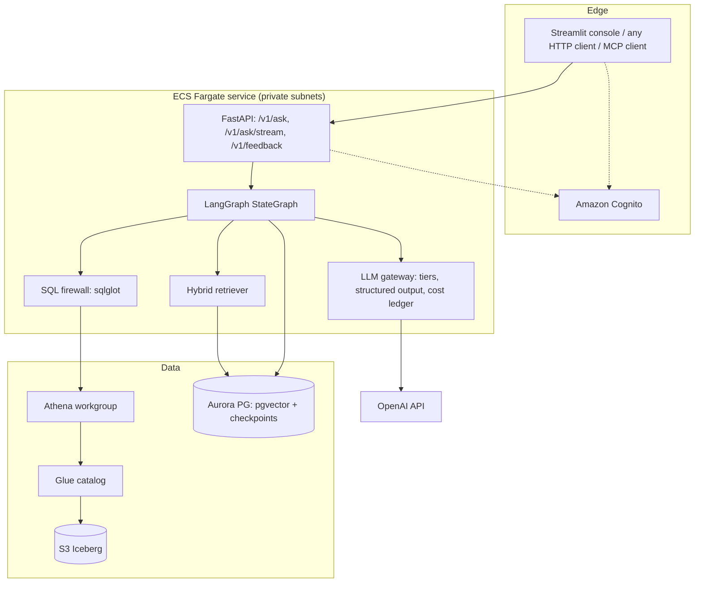

# Architecture

## 1. Context

| | |
|---|---|
| **Users** | merchandising, marketing, operations and leadership at an online fashion retailer |
| **Job** | answer ad-hoc data questions in plain English, correctly, with the SQL shown |
| **Data** | 7 tables (orders, order items, products, inventory, customers, web events, distribution centers), 2019-01 to 2024-03, about 3.3M rows in the real dataset |
| **Constraints** | paid OpenAI models (no Bedrock), LangChain + LangGraph, AWS hosting, customer PII must never reach users or the model |

**Goals:** trusted answers (certified metrics), explainability, governance, predictable cost,
measurable quality.
**Non-goals (v1):** write-back to data, forecasting, multi-tenant SaaS, free-form Python analysis.

## 2. Container view



| Container | Responsibility | Scales by |
|---|---|---|
| FastAPI | auth, request validation, SSE streaming, feedback | ECS task count (CPU target 60%) |
| LangGraph | orchestration, retries, interrupts, per-thread state | in-process, stateless between requests (state in Postgres) |
| LLM gateway | model tier selection, strict JSON-schema output, usage → USD | OpenAI rate limits (tier) |
| Retriever | dense (pgvector HNSW) + sparse (Postgres full-text) fused with RRF | Aurora ACUs |
| SQL firewall | single SELECT, allow-listed tables, PII columns, LIMIT | CPU, microseconds |
| Athena | executes Trino SQL on Iceberg | serverless; cost by bytes scanned |

## 3. Request lifecycle

```mermaid
sequenceDiagram
  participant U as User
  participant A as API
  participant G as LangGraph
  participant O as OpenAI
  participant V as pgvector
  participant Q as Athena
  U->>A: POST /v1/ask (JWT)
  A->>A: verify Cognito JWT, check daily budget, answer cache
  A->>G: invoke(thread_id, RunContext(ledger, user, role))
  G->>G: guard_input (length, injection, PII request, optional moderation)
  G->>O: route_intent (nano, strict schema)
  G->>V: hybrid search (tables, metrics, examples)
  G->>O: generate_sql (mini; gpt-5.4 on retry)
  G->>G: validate_sql (sqlglot firewall)
  G->>Q: execute (task role, workgroup caps)
  G->>G: build_chart (deterministic)
  G->>O: compose_answer (nano) + faithfulness check
  G->>G: guard_output (PII scan), finalize (history, cost)
  A-->>U: answer, SQL, rows, chart, cost, trace
```

## 4. Key design choices

| Choice | Alternative | Why | ADR |
|---|---|---|---|
| Explicit LangGraph state machine | ReAct tool-calling agent | predictable, testable per node, bounded cost | [0001](adr/0001-langgraph-state-machine.md) |
| Certified semantic layer in Git | prompt rules / whole schema in prompt | reviewed definitions, retrieval scales past 7 tables | [0002](adr/0002-semantic-layer.md) |
| Athena + Iceberg on S3 | Redshift, RDS | serverless, pay per scan, governed by Glue/Lake Formation | [0003](adr/0003-athena-iceberg.md) |
| OpenAI paid models with tiers | single model / Bedrock | team credits, cascade keeps cost low | [0004](adr/0004-openai-model-tiers.md) |
| Aurora pgvector for vectors + checkpoints | OpenSearch, S3 Vectors, DynamoDB | one managed store, scales to zero | [0005](adr/0005-aurora-pgvector.md) |
| Deterministic chart specs | LLM-generated Plotly code + exec() | no code execution, zero tokens | [0006](adr/0006-no-generated-code.md) |
| Evaluation gate in CI | manual testing | every change is measured | [0007](adr/0007-evaluation-gate.md) |
| ECS Fargate | Lambda, AgentCore Runtime | long requests + streaming, simple ops, portable container | [0008](adr/0008-ecs-fargate.md) |

## 5. Data architecture

* **Raw → curated** (`insightly data curate`): timestamp parsing, category merge, channel mapping,
  test-price flag, PII split.
* **Publish** (`insightly data publish`): staging Parquet → Glue external tables (`insightly_raw`) →
  CTAS into Iceberg (`insightly_curated`), partitioned where time filters are common.
* **PII**: `users_pii` (names, email, street, postcode, coordinates) lives in the curated database
  but is not in the semantic layer, is rejected by the SQL firewall, and is explicitly denied to
  the ECS task role in IAM. Three independent controls.
* **Dialect**: the agent writes Trino SQL. Locally sqlglot transpiles it to DuckDB, so the same
  prompts, examples and golden set run on a laptop and on Athena.

## 6. State and memory

| State | Store | Lifetime |
|---|---|---|
| Conversation (per `thread_id`) | LangGraph `PostgresSaver` checkpoints | until deleted |
| Turn history used for follow-ups | `history` field in graph state (last 3 turns sent to the router) | per thread |
| Paused clarification | checkpoint + `interrupt()`; resumed with `Command(resume=...)` | per thread |
| Answer cache | in-process TTL cache | 15 min, per task |
| Daily spend | in-process counter | per UTC day, per task (AWS Budgets is the account-level backstop) |

## 7. Failure modes

| Failure | Behaviour |
|---|---|
| Invalid SQL / Athena error | error text fed back to `generate_sql`; strong model after first failure; `fail` after 3 attempts |
| OpenAI timeout / 5xx | 2 client retries with backoff (LangChain), then the request fails with status `failed` |
| Budget reached | node returns `budget_exceeded`, graph finalizes with a clear message |
| Unfaithful answer (invented number) | replaced with a deterministic summary of the result |
| PII in output | rows and chart withheld, status `refused` |
| Aurora paused | first request waits for resume (about 15 s); warm-up failures never crash the task |
| Bad deployment | ECS circuit breaker rolls back automatically |

## 8. Service level objectives

| SLO | Target | Measured by |
|---|---|---|
| Execution accuracy | ≥ 85% release gate | `insightly eval run` |
| Availability | 99.5% monthly (internal tool) | ALB 5xx alarm |
| p95 latency | ≤ 12 s | EMF `LatencyMs` p95 alarm |
| Cost per question | ≤ $0.03 | ledger, gate, `CostUSD` alarm |
| PII exposure | 0 | red-team gate, output guard |

## 9. Evolution path

1. Lake Formation row-level filters per business unit, role passed from Cognito groups.
2. Multi-step analysis ("why did revenue drop?") as a sub-graph with a planner node.
3. Semantic layer authored in dbt metrics / a semantic model, exported to YAML.
4. Streaming tokens of the answer text; React front end on Amplify Hosting.
5. Move the agent runtime to Amazon Bedrock AgentCore Runtime if the company standardises on it
   (it hosts LangGraph and calls OpenAI unchanged).
