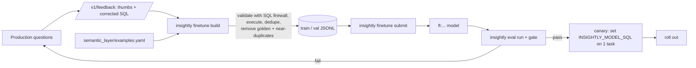

# Fine-tuning

Fine-tuning is the last lever, not the first. Order of work: semantic layer → verified examples
→ prompt rules → model tier → fine-tuning. Fine-tune when the evaluation plateaus and the
error analysis shows systematic SQL mistakes that more context does not fix, or when you want
the same accuracy from a cheaper model (distillation).

## Data flywheel



## Commands

```bash
uv run insightly finetune build                    # writes data/finetune/*.jsonl, prints counts and drops
uv run insightly finetune submit --method supervised --base-model <model> --dry-run
uv run insightly finetune submit --method supervised --base-model <model>
uv run insightly finetune status <job-id>
```

* **Supervised (SFT)**: chat-format examples (system prompt + retrieved context → `SQLDraft` JSON).
  Use it to distil verified SQL into a smaller model.
* **Reinforcement (RFT)**: the model is optimised against a Python grader
  (`finetune/jobs.py::PYTHON_GRADER`) that scores structural agreement with the reference SQL
  (tables, aggregates, GROUP BY, years, the certified status rule). The grader cannot reach
  Athena, so execution accuracy is confirmed afterwards by the eval gate.

**Which base models support which method changes over time.** Check the OpenAI fine-tuning
guide for the current list before submitting, then pass it as `--base-model` or
`INSIGHTLY_FT_BASE_MODEL`. Add the fine-tuned model's price to `config/pricing.yaml`.

## Data rules
* Minimum 10 examples to run; aim for several hundred clean examples before expecting gains.
* Analyst corrections are always included; thumbs-up answers only if their SQL still validates
  and executes.
* Golden questions and near-duplicates (token Jaccard ≥ 0.8) are removed to keep evaluation honest.
* PII cannot appear: every example passes the SQL firewall.

## Promotion
1. `INSIGHTLY_MODEL_SQL=ft:... uv run insightly eval run`
2. `uv run insightly eval gate --baseline reports/eval/<current-production-run>`
3. Compare `execution_accuracy`, `cost_per_question_usd`, `latency_p95_ms` in the two `report.md` files.
4. Canary: update the ECS task environment for one deployment, watch the dashboard for 24 h.
5. Promote or roll back (runbook).
